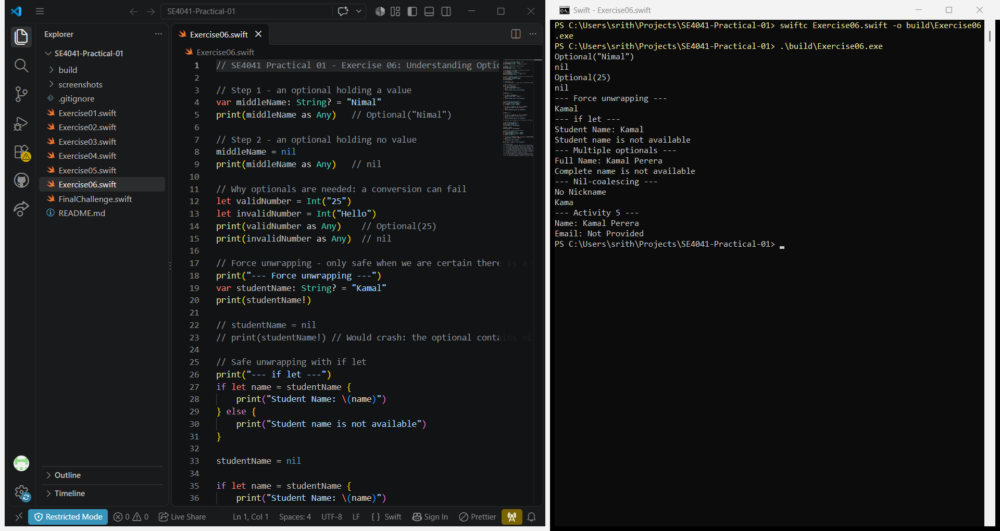
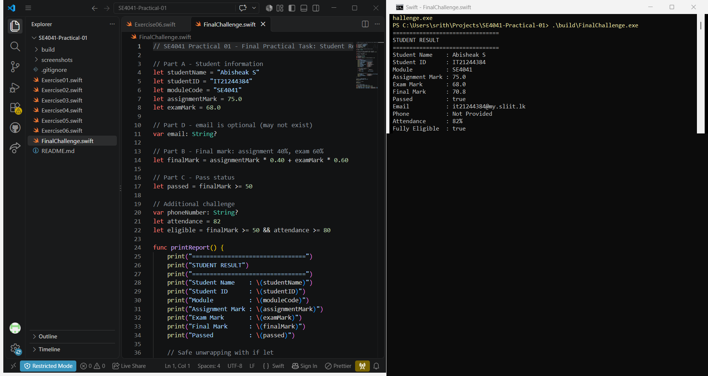
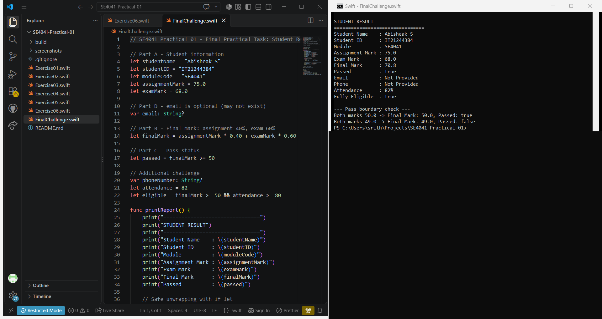

# SE4041 – Practical 01: Swift Fundamentals

Swift basics – constants and variables, data types, type conversion, operators, strings and optionals – ending with a Student Result Analyzer program.

**Name:** Abisheak S  
**Student ID:** IT21244384

## Screenshots

